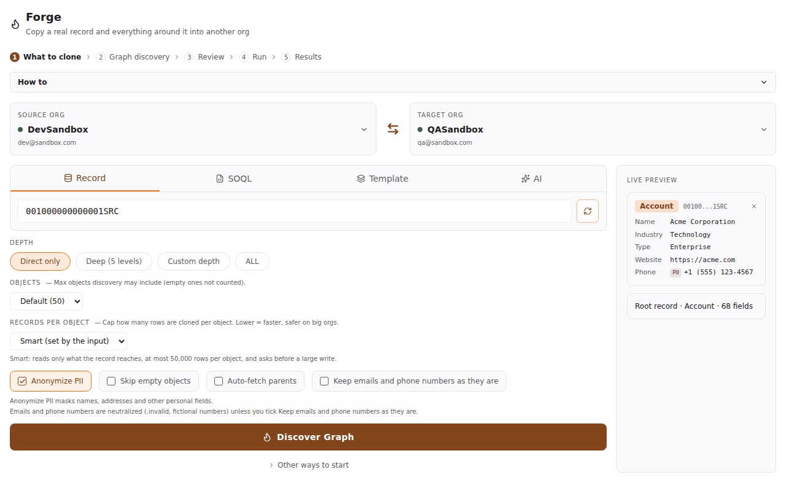
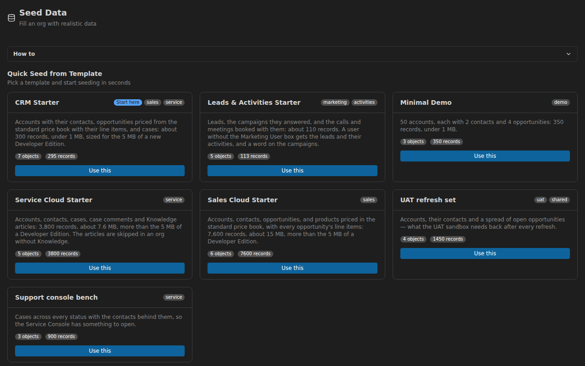
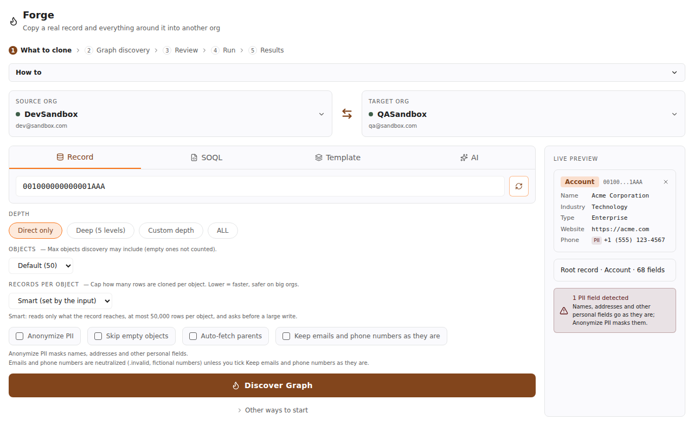
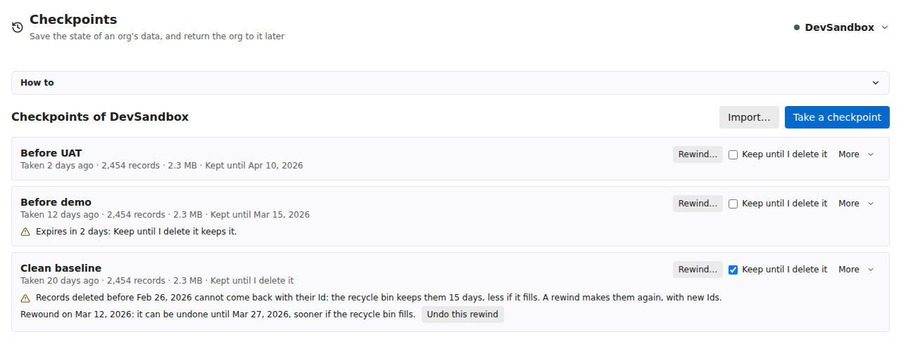

<!-- Generated from README.md by scripts/sync-extension-readme.mjs: edit README.md, then run it. -->

# SandForge: Realistic Data for Salesforce Sandboxes

<!-- badges:start -->

<!-- badges:end -->

**Forge your Salesforce sandboxes.** SandForge fills a sandbox, a scratch org or a Developer Edition org with realistic data: generated from a template, with no AI key, or cloned from a real record of another org, with production guardrails. One WebView UI, no Command Palette required.

Website: [sandforge.fr](https://sandforge.fr/en/) · [en français](https://sandforge.fr/)

---

## One empty org? Fill it in a minute

A Developer Edition, a Trailhead playground or a fresh scratch org is all you need: no second org, no AI key, no field rule to write.

1. **Connect your org**: in the SandForge launcher, which opens in the side bar on its own (or from the SandForge icon in the Activity Bar), pick **Connect your first org**.
2. **Open Seed**: the launcher's **Fill \<alias\> with demo data** opens Seed's template gallery on that org.
3. **Pick a template**: **CRM Starter**, marked _Start here_, writes about 300 linked accounts, contacts, products, opportunities and cases. Click **Use this**.
4. Click **Start seeding**. A seed that would not fit the org's data storage, or the emails it has left today, is refused before its first record.
5. **Take it back** whenever you want, from **What this run created** on the results or **History** under the gallery.

---

## Why switch from SFDMU or Data Loader?

- **No config file to author.** Paste a record ID: BFS discovery walks the relationship graph for you and lookups are remapped on write (a record type the target does not have keeps its source Id, and the SandForge log names it).
- **No mandatory CSV round-trip.** Records move org to org over the API. CSV import is still there when you want it.
- **Production Guard on by default.** Forge refuses a production org as a target, and so do a Frozen Dataset load and Checkpoints, which does not even take a checkpoint of one; Seed, Sync, Autopilot and DataOps ask you before every write to one, and DELETE there is blocked outright.
- **Your SFDMU config comes with you.** The SFDMU Import page imports an `export.json` into a Sync config, and names first what Sync will not do as SFDMU would.

Side by side, with sources: [SandForge, SFDMU and Data Loader compared](https://sandforge.fr/en/compare/).

---

## Your first clone in 2 minutes

Two orgs, one holding real records (a UAT or partial-copy sandbox, say) and one to fill? Forge copies a record and everything around it from the first into the second.

1. **Connect your orgs**: in the launcher's org dropdown, choose **New organization...**, then **Import from Salesforce CLI**.
2. **Open Forge**: click the flame icon in the sidebar.
3. **Paste a root record ID** (an Account works well) and pick the org you fill as the target, then click **Discover Graph**.
4. Click **Continue to Review**: Review says the run in one sentence and what is left to decide, with **Simulate** and **Execute Forge** beside it. IDs are remapped as the records are written; a record type with no active record type of the same API name on the target keeps its source Id, and the SandForge log names it.

---

## First steps, safely

1. **Clone into a Developer sandbox or a scratch org.** Forge writes only to a sandbox, a scratch org or a Developer Edition org; it refuses a production org, and any org whose kind SandForge does not know.
2. **Simulate first.** It takes every record through the write stage and writes nothing, then says what a real run would insert and the gaps it found.
3. **Read the Automation and Gaps rows.** They list what the target runs on the records and what it would refuse, each gap with the decisions it allows; a real run asks you before what fires on insert and update.
4. **Emails and phone numbers are neutralized by default:** written under `.invalid` and as fictional numbers, so the target's automation reaches no one; past 10,000 distinct numbers in one run, a phone field is left empty.
5. **Rehearse when the target has validation rules or triggers.** The target judges the rows in calls it rolls back, every row when the run creates 200 or fewer; platform events published immediately and callouts already made are not rolled back.
6. **Remove a run from Results.** **Remove the records this run created** deletes them into the target's recycle bin, and keeps what someone changed since; **Checkpoint first** lets you rewind instead.

---

## Modules

SandForge ships 15 modules in a single extension:

| Module                | What it does                                                                                                                                                                                                                                                                                                                                                                                                                   |
| --------------------- | ------------------------------------------------------------------------------------------------------------------------------------------------------------------------------------------------------------------------------------------------------------------------------------------------------------------------------------------------------------------------------------------------------------------------------ |
| **Forge**             | Clone a record, the records a query chooses, a whole org or a sample of it that fits the target, with BFS dependency discovery and automatic ID remapping. [Guide](https://github.com/StephaneBerthoz/sandforge/blob/master/docs/forge-quickstart.md)                                                                                                                                                                          |
| **Frozen Dataset**    | Extract once, pseudonymize deterministically, replay identically after every sandbox refresh. [Guide](https://github.com/StephaneBerthoz/sandforge/blob/master/docs/modules/frozen-dataset.md)                                                                                                                                                                                                                                 |
| **Seed**              | Fill an empty org from a built-in template in a minute, with no AI key; or generate data for the objects you choose (Faker, AI optional), import a CSV, or copy objects from another org. [Guide](https://github.com/StephaneBerthoz/sandforge/blob/master/docs/modules/seed.md)                                                                                                                                               |
| **Checkpoints**       | Keep the state of an org's data at a moment on this machine, and return the org to it: after a preview, Rewind deletes what was created since, gives back what was changed and brings back what was deleted — with View All Data and Modify All Data, whoever did it; the rewind itself can be undone. Never on a production org. [Guide](https://github.com/StephaneBerthoz/sandforge/blob/master/docs/modules/checkpoint.md) |
| **Sync**              | Source-to-target sync between orgs with field mapping, transforms, and conflict resolution against the target. [Guide](https://github.com/StephaneBerthoz/sandforge/blob/master/docs/modules/sync.md)                                                                                                                                                                                                                          |
| **Monitor**           | API limits, jobs, storage and a health score, with threshold alerts, and the runs under way in Live Operations. [Guide](https://github.com/StephaneBerthoz/sandforge/blob/master/docs/modules/monitor.md)                                                                                                                                                                                                                      |
| **Compare**           | Metadata diff, permission set and profile presence, and five Organization settings, compared between two orgs. [Guide](https://github.com/StephaneBerthoz/sandforge/blob/master/docs/modules/compare.md)                                                                                                                                                                                                                       |
| **DataOps**           | Masking, with a snapshot of the records an anonymization writes over and its restore; personal data requests; a cleanup scan that counts each field's fill, through Production Guard; and the emptying of objects or a whole org, with Undo. [Guide](https://github.com/StephaneBerthoz/sandforge/blob/master/docs/modules/dataops.md)                                                                                         |
| **Automation**        | Pipelines of `backup`, `checkpoint`, `compare`, `precheck`, `notification`, `delay`, `condition`, `approval`, `sync`, `seed`, `anonymize` and `rewind` steps, run by hand, on a cron schedule or a sandbox refresh while VS Code is open, or exported to run with VS Code closed. [Guide](https://github.com/StephaneBerthoz/sandforge/blob/master/docs/modules/automation.md)                                                 |
| **AI Assistant**      | Chat, NL2SOQL, pipeline drafts and Seed field rules on your Anthropic key. Failed runs send their error for a fix unless `sandforge.ai.errorResolution` is off; known codes answer with AI off. [Guide](https://github.com/StephaneBerthoz/sandforge/blob/master/docs/modules/ai-assistant.md)                                                                                                                                 |
| **Back into service** | After a sandbox refresh, the ten steps that hand it back to its testers, each with its status: users set up after a simulation, masking, the checkpoint of before replayed, audits, a handoff note. [Guide](https://github.com/StephaneBerthoz/sandforge/blob/master/docs/modules/recovery.md)                                                                                                                                 |
| **SFDMU Import**      | Import SFDMU `export.json` files, with their `FieldMapping.csv` and `ValueMapping.csv`, into Sync configs run from Sync, naming first what Sync will not do as SFDMU would. [Guide](https://github.com/StephaneBerthoz/sandforge/blob/master/docs/modules/migration.md)                                                                                                                                                        |
| **Autopilot**         | Copy whole objects in dependency order, or the share the target's data storage holds; emails and phone numbers neutralized by default, masking optional. A run cannot be removed. [Guide](https://github.com/StephaneBerthoz/sandforge/blob/master/docs/modules/autopilot.md)                                                                                                                                                  |
| **Organizations**     | Org registry with SF CLI import and tier-based safety coloring; when SandForge first opens a view in a window, expired sessions are refreshed through the sf CLI.                                                                                                                                                                                                                                                              |
| **Reports**           | Run reports and success rates, an audit trail of every run that writes to an org, and the data lineage of the records each run carried. [Guide](https://github.com/StephaneBerthoz/sandforge/blob/master/docs/modules/reports.md)                                                                                                                                                                                              |

Safety is on by default: Forge and a Frozen Dataset load refuse a Production org as a target, Checkpoints never takes a checkpoint of a Production org nor rewinds one, and for every other module Production Guard asks for confirmation before any write on a Production org and blocks DELETE there.

---

## Which tool copies my data?

| What the org needs                                       | Use                                      | Taking it back                                                                                                       |
| -------------------------------------------------------- | ---------------------------------------- | -------------------------------------------------------------------------------------------------------------------- |
| Nothing copied: realistic records in an empty org        | **Seed**, from a template of its gallery | **What this run created**, on the results, or **History**                                                            |
| One record, or a query's records, and what hangs on them | **Forge**                                | **Remove the records this run created**, on the results or under **History**                                         |
| Whole objects, filtered and mapped, as often as needed   | **Sync**                                 | **Remove what this run created**, on the results or the run's history entry                                          |
| Whole objects in dependency order, in one go             | **Autopilot**                            | A run cannot be removed; **Rewind…** to a checkpoint taken before it: **Checkpoint first**, on its review, takes one |
| The same set after every sandbox refresh                 | **Frozen Dataset**                       | **Remove the records this load created**, under **Remove the last load** on the Load tab                             |
| Everything the source org holds, in one go               | **Forge**, the ALL depth                 | **Remove the records this run created**, under **History**                                                           |
| Nothing left: the objects you pick, or the whole org     | **DataOps → Emptying**                   | **Undo**, on its results, while the recycle bin holds them                                                           |

Seed's **CSV Upload** and **Copy records from another org** are taken back as a seed is, from their results or **History**: [the FAQ](https://github.com/StephaneBerthoz/sandforge/blob/master/docs/faq.md#how-do-i-undo-what-sandforge-wrote) says what each module can undo.

---

## Rewind an org to a checkpoint

Before a test session, a demo or a training, take a checkpoint of the org; afterwards, Rewind returns its data to that moment, whoever changed it since — you, your testers, flows or integrations — when the user SandForge connects as has View All Data and Modify All Data. **Take a checkpoint** keeps the records' values on this machine, unencrypted, readable by you alone; **Rewind…** previews first what it would delete, give back and bring back. **Undo this rewind**, offered on the org's last rewind for 15 days, returns the org to how it was before the rewind and keeps what anyone changed since. What the rewind deleted comes back while the recycle bin holds it, and the preview names first what Undo could not bring back.

Checkpoints never takes a checkpoint of a production org nor rewinds one. It rewinds data, the files attached to the records it holds among them, not metadata, users or the content of files: [the guide](https://github.com/StephaneBerthoz/sandforge/blob/master/docs/modules/checkpoint.md) says what a rewind leaves as it is. Tick **Checkpoint first** before a Forge, Sync, Seed, Autopilot or Frozen Dataset run and it keeps its own way back; **Replay in another org…** sets a checkpoint's records up in another org, with new Ids. From the `sandforge` npm package or a checkout of this repository, [`sandforge checkpoint`](https://github.com/StephaneBerthoz/sandforge/blob/master/docs/modules/checkpoint.md#from-the-command-line) takes, previews, rewinds and undoes the same way without the editor.

---

## Test data as code, for the command line & CI

A `sandforge.yaml` committed with your project says what records its tests need -- so many accounts, so many contacts under each, records cloned from an org it names, a Frozen Dataset it loads, or the records a sandbox copied from production already holds, masked -- and, once a sandbox is refreshed, the users its testers sign in as, handed back by a users resource, and the records it held before, from a checkpoint a replay resource replays. `sandforge env` applies it to a scratch org, a Developer Edition or a sandbox: `plan` says what it would do, `apply` writes it through Seed, Forge, Frozen Dataset and DataOps, `sandforge users` and `sandforge checkpoint replay`, the users first, and, applied again, writes nothing, and `destroy` takes it back into the recycle bin, but never unmasks what it masked. A production org is refused before anything is read. [The guide](https://github.com/StephaneBerthoz/sandforge/blob/master/docs/environments.md) has the file and the pattern for a pipeline; [After a sandbox refresh](https://github.com/StephaneBerthoz/sandforge/blob/master/docs/environments.md#after-a-sandbox-refresh), the one command that hands a refreshed sandbox back, and what no refreshed sandbox has proven yet.

The scripts run from the `sandforge` npm package, as an sf plugin or from a checkout ([Requirements](#requirements)), and an AI agent reaches them as the tools of an [MCP server](https://github.com/StephaneBerthoz/sandforge/blob/master/docs/mcp.md). [The CI examples](https://github.com/StephaneBerthoz/sandforge/blob/master/ci-examples/README.md) carry what a pipeline needs.

**In the editor**, with Red Hat's [YAML extension](https://marketplace.visualstudio.com/items?itemName=redhat.vscode-yaml) installed, VS Code checks a `sandforge.yaml` or a `sandforge.yml` as you type it, against a schema generated from the one `sandforge env validate` reads the file with: an unknown key or a value of the wrong type is underlined, and hovering a key says, in English, what it holds, its default and what it refuses. The YAML extension is what reads that schema; without it, the editor checks nothing. `validate` checks the rest, offline -- each resource against its module's own rules, the order of the resources, the variables the file names.

---

## FAQ

- **Does my data leave my machine?** Only to the orgs you connect, until you turn the AI Assistant on (it is off by default) and store your own key. From then on, its features send what they need to Anthropic, and a failed run's error message goes too, unless `sandforge.ai.errorResolution` is off; [the FAQ](https://github.com/StephaneBerthoz/sandforge/blob/master/docs/faq.md#is-my-data-sent-to-external-services) lists what each feature sends.
- **Can I point it at production?** To read, yes, except with Checkpoints: it refuses a production org outright, even to take a checkpoint or preview a rewind, which only read. Forge and a Frozen Dataset load never write to one: they refuse a production target outright. The writes of Seed, Sync, Autopilot and DataOps go through the Production Guard: a confirmation before each, and destructive operations (DELETE) are blocked outright.
- **Is this an SFDMU replacement?** For moving data between orgs from your editor, yes, and without the config file. SFDMU keeps the edge for headless CI, where it is a binary you install; SandForge's fifteen [command-line scripts](https://github.com/StephaneBerthoz/sandforge/blob/master/ci-examples/README.md) run with `npx sandforge`.
- **Can I undo a run?** Forge, Seed, Sync and Frozen Dataset each take back what a run created; Autopilot cannot, but a checkpoint taken before any run, on a sandbox, a scratch org or a Developer Edition, rewinds the org to it.
- **Is it free?** Yes — MIT licensed, no account, no paid tier.

---

## Documentation

| Guide                                                                                                              | Description                                                                                                                                                                                      |
| ------------------------------------------------------------------------------------------------------------------ | ------------------------------------------------------------------------------------------------------------------------------------------------------------------------------------------------ |
| [Getting Started](https://github.com/StephaneBerthoz/sandforge/blob/master/docs/getting-started.md)                | Install, connect your org, run your first operation                                                                                                                                              |
| [Forge: Dev Sandbox Quickstart](https://github.com/StephaneBerthoz/sandforge/blob/master/docs/forge-quickstart.md) | Clone a record graph from a partial-copy sandbox into your dev sandbox                                                                                                                           |
| [Forge: Reference](https://github.com/StephaneBerthoz/sandforge/blob/master/docs/forge-reference.md)               | Every check, decision and file a Forge run reads, writes and keeps                                                                                                                               |
| [Checkpoint & Rewind](https://github.com/StephaneBerthoz/sandforge/blob/master/docs/modules/checkpoint.md)         | Take a checkpoint, preview a rewind, rewind the org whoever changed it since (with View All Data and Modify All Data), and undo the rewind                                                       |
| [Environments as code](https://github.com/StephaneBerthoz/sandforge/blob/master/docs/environments.md)              | `sandforge.yaml`, its resources, and a sandbox handed back after a refresh                                                                                                                       |
| [Command line & CI](https://github.com/StephaneBerthoz/sandforge/blob/master/ci-examples/README.md)                | Fifteen scripts, from the `sandforge` npm package or a checkout: seed, clone, sync, mask, take a checkpoint, rewind the org and undo the rewind, apply a `sandforge.yaml`; and four CI pipelines |
| [MCP server](https://github.com/StephaneBerthoz/sandforge/blob/master/docs/mcp.md)                                 | The tools an AI agent reaches                                                                                                                                                                    |
| [Configuration](https://github.com/StephaneBerthoz/sandforge/blob/master/docs/configuration.md)                    | Every setting, the keyboard shortcuts and the languages                                                                                                                                          |
| [FAQ & Troubleshooting](https://github.com/StephaneBerthoz/sandforge/blob/master/docs/faq.md)                      | Common questions and solutions to frequent issues                                                                                                                                                |

---

## Requirements

| Requirement           | Version            |
| --------------------- | ------------------ |
| Visual Studio Code    | 1.95+              |
| Salesforce CLI (`sf`) | Latest             |
| AI API key (optional) | Anthropic (Claude) |

The [command-line scripts](https://github.com/StephaneBerthoz/sandforge/blob/master/ci-examples/README.md) need neither VS Code nor the extension. The `sandforge` npm package runs them with Node.js 20.19 or later and no checkout -- `npx sandforge --help`, and `claude mcp add sandforge -- npx -y sandforge mcp` for the [MCP server](https://github.com/StephaneBerthoz/sandforge/blob/master/docs/mcp.md) --, or as an sf plugin, on sf's own Node: `sf plugins trust allowlist add --name sandforge`, `sf plugins install sandforge`, then `sf sandforge --help` ([why the allowlist](https://github.com/StephaneBerthoz/sandforge/blob/master/packages/cli/README.md#as-an-sf-plugin)); from a checkout of this repository they run with Node.js 24 and pnpm 11, once `pnpm install` and `pnpm build:shared` have run.

---

## Installation

### From Marketplace (recommended)

In VS Code, open Extensions (`Ctrl+Shift+X`), search for **SandForge**, then click **Install**.

### From VSIX

Download `sandforge.vsix` from the [Releases](https://github.com/StephaneBerthoz/sandforge/releases) page, then run **Extensions: Install from VSIX...** from the Command Palette.

---

## Support

- [Website and guides: sandforge.fr](https://sandforge.fr/en/)
- [Report an issue](https://github.com/StephaneBerthoz/sandforge/issues)
- [Ask a question (Q&A)](https://github.com/StephaneBerthoz/sandforge/discussions)
- [Changelog](https://github.com/StephaneBerthoz/sandforge/blob/master/changelog.md)
- [Security policy](https://github.com/StephaneBerthoz/sandforge/blob/master/SECURITY.md)

Missing a feature? [Open a feature request](https://github.com/StephaneBerthoz/sandforge/issues/new?template=feature_request.yml) — responses are fast.

## Author

**Stephane Berthoz**

## License

[MIT](https://github.com/StephaneBerthoz/sandforge/blob/master/LICENSE)
